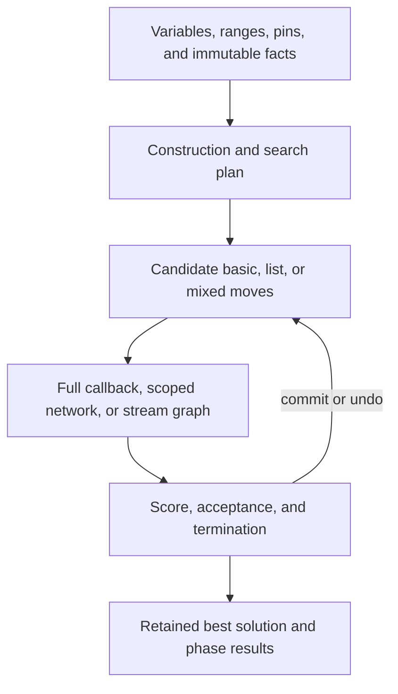

# Architecture

TimeTuck is one Rust library crate, `timetuck`, in `crates/solver/`. The production
library runs natively; Java adapters and the pinned upstream checkout are
development references.

## From a problem to a solution

Basic models choose values from finite ranges. List models place values in ordered
entity lists with unique ownership. Mixed models couple both decision types under
one score and shared search limits. Pins and range validation constrain the legal
states; moves change those states reversibly.

Scores compare lexicographically across structural/initialization, hard, and softer levels.
Search maximizes the score. Construction creates an initial assignment; local
search and repair improve it within explicit limits. Exact enumeration and
branch-and-bound serve small finite problems and independent quality checks.
Only exhausted exact search can establish optimality under its documented bound
assumptions.

## Scoring and rollback

A direct callback can recompute a complete score. Scoped constraint networks
cache affected contributions. Persistent stream graphs propagate tuple changes
through filters, joins, collectors, derived values, and weighted score nodes.

Candidate evaluation uses transactions. Rejected candidates restore planning
state and supported score/dependency caches; accepted candidates retain the new
state. Retained best solutions and checkpoints support search and phase handoffs.
User callback side effects and allocation aborts are outside rollback guarantees.
See the [stream contract](constraint-stream-contract.md) for the exact policies.

## Solving services

Basic, list, and mixed solving entry points orchestrate construction and ordered
improvement phases. They report work and termination, share configured limits,
and support cooperative cancellation. Owned factories, managed jobs, live changes,
and persistence build on those native contracts rather than Java reflection or
framework loading. See the [solver contract](solver-contract.md).

## Repository map

| Path | Purpose |
| --- | --- |
| `crates/solver/src/` | Native library implementation |
| `crates/solver/examples/` | Complete examples, comparison drivers, and application support |
| `crates/solver/tests/` | Adapted Community cases and native regressions |
| `tests/application/` | Separately attributed application fixtures |
| `compat/` | Pin, provenance, exclusions, and retained evidence |
| `compat/oracle/` | Development Java public-API adapters |
| `upstream/timefold-solver/` | Unmodified pinned Community reference submodule |
| `scripts/` | Verification, comparisons, inventories, and report generation |
| `dashboard/` | Local presentation of generated evidence |
| `work/`, `dashboard/data/` | Ignored local outputs and downloaded development artifacts |

The evidence pipeline distinguishes upstream adaptations, original regressions,
and application tests. It binds executions and measurements to source and input
hashes, and keeps stale records visible. The [compatibility overview](timefold-compatibility.md)
and [performance guide](performance.md) explain what those records establish.
